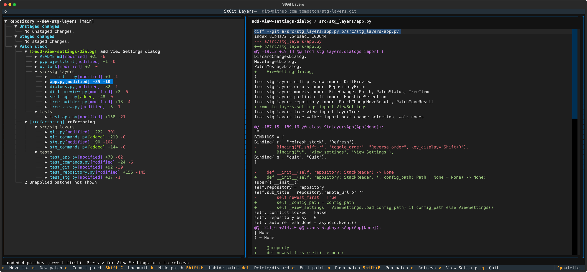

# StGit Layers

A Textual browser for StGit repositories, with a patch tree and a read-only diff
preview. Stage, unstage, discard, and move files, hunks, or selected lines between layers.



## Requirements

- Python 3.14 or newer
- Git
- StGit (`stg`)

## Install and run

Install the tool from a checkout with `uv`:

```console
uv tool install .
cd /path/to/stgit-repository
stg-layers
```

## Tree layout

The tree root shows the repository directory and branch. The title bar shows the
remote URL, preferring `origin`.

| Item | Display and scope |
| --- | --- |
| Change group | All staged or unstaged files, including files in collapsed directories. Non-ignored untracked files appear as unstaged additions. |
| Patch | Expands into directories, files, and hunks. Labels show `[status patch-id] title`. |
| Directory | Contains all descendant files. Directory chains without intermediate files are combined, e.g. `src/stg_layers`. |
| File | Shows its status and insertion/deletion counts, e.g. `app.py [modified] +12-3`. File operations include all its hunks. |
| Hunk | One text hunk. Hunk operations preserve the other hunks in the file. |

Sections, patches, and directories start expanded; file hunks start collapsed.
Patch status markers are:

| Marker | Meaning |
| --- | --- |
| `>` | Current patch |
| `+` | Applied patch |
| `-` | Unapplied patch |
| `~` | Hidden patch |

## View Settings

Press **v** from either pane to open View Settings. Select **Apply** to use your
choices, or press **Escape** or select **Cancel** to keep the current settings.

| Setting | Default | Effect |
| --- | --- | --- |
| **Display order** | Newest first | Shows Unstaged changes → Staged changes → Patch stack, with patches newest to oldest. **Oldest first** reverses the section and patch order. |
| **Show Hidden patches** | On | Shows hidden patches in the tree. |
| **Show Unapplied patches** | On | Shows unapplied patches in the tree. |
| **Wrap lines in diff preview** | Off | Wraps long lines to fit the diff pane. |

When a filter omits patches, the end of the patch stack shows the count for that
status, for example, `2 Hidden patches not shown` or
`1 Unapplied patches not shown`. Filters stay active when you refresh.

View Settings are saved when you select **Apply** and restored when you relaunch
the app. They are shared across repositories and stored in `stg-layers/config.toml`
under your user config directory. On Linux, this is
`${XDG_CONFIG_HOME:-$HOME/.config}/stg-layers/config.toml`.

## Keyboard commands

### General and tree navigation

| Key | Focus / selected item | Action |
| --- | --- | --- |
| **q** | Either pane | Quit. |
| **r** | Either pane | Refresh repository state. |
| **v** | Either pane | Open [View Settings](#view-settings). |
| **Tab / Shift+Tab** | Either pane | Move focus between the tree and diff preview. |
| **Up / Down** | Tree | Select the previous / next visible node and update the preview. |
| **Right** | Expandable tree node | Expand it, or move to its first child if already expanded. |
| **Right** | Hunk | Focus the diff preview. |
| **Left** | Tree | Collapse the node, or move to its parent. |

### Stage, unstage, and discard

These commands apply when the **tree** is focused.

| Key | Selected item | Action |
| --- | --- | --- |
| **Enter** | Unstaged/Staged group, directory, file, or hunk | Stage/Unstage the selection. |
| **m** | Group, directory, file, or hunk | Move the selection from Unstaged, Staged, or a patch to Unstaged, Staged, or any other patch. Groups and directories move all contained files. Select **Move** to confirm or **Cancel** to leave changes in place. |
| **Delete** | Unstaged group, directory, file, or hunk | Confirm, then discard the selection. Tracked files are restored from the index; untracked files are removed. Staged changes are preserved. **Discard cannot be undone.** |

After Enter on a file or hunk, selection advances within the source group.
On a group or directory, selection stays with that source group or directory.
Empty groups are left unchanged. Staging and unstaging leave working-tree contents
unchanged.

### Move changes and reorder patches

**Ctrl+Up / Ctrl+Down** move in the displayed direction. This table describes the
**default tree order**. The two keys swap roles in **Oldest first** order.

| Selected item | Ctrl+Up — toward newer layers | Ctrl+Down — toward older layers |
| --- | --- | --- |
| Unstaged group, directory, file, or hunk | No move: already at the edge. | Stage the selection. |
| Staged group, directory, file, or hunk | Unstage the selection. | Move the selection into the current patch. |
| Current-patch directory, file, or hunk | Spill the selection into staged changes. | Move the selection into the adjacent older applied patch. |
| Other applied-patch directory, file, or hunk | Move the selection into the adjacent newer applied patch. | Move the selection into the adjacent older applied patch. |
| Unapplied or hidden patch contents | No move. | No move. |
| Patch node | Reorder one position toward newer patches. | Reorder one position toward older patches. |

Selection follows the moved item. Directory
and group operations include all contained files, including collapsed descendants.
These directional transfers and reordering stop at stack edges and do not cross
the applied/unapplied boundary. The **m** target picker also supports nonadjacent,
unapplied, and hidden patches, preserving patch order and visibility.

Whole-file and directory spills require the selected paths to have no staged
changes; unstage those changes first. Hunk moves between the current patch and
staged changes preserve other staged and unstaged changes, including those in the
same file.

### Patch commands

These commands apply when the **tree** is focused.

| Key | Selected item | Action |
| --- | --- | --- |
| **n** | Any | Open the new-patch message editor. **Create** adds an empty patch on top of the applied stack. |
| **e** | Patch | Open its message editor. **Update** applies the edited message. |
| **p** | Unapplied patch | Push/apply the patch using `stg push`. StGit may reorder patches as needed. |
| **Shift+P** | Applied or current patch | Pop/unapply the patch using `stg pop`. |
| **c** | Patch | Commit the patch into the stack's base using `stg commit`. StGit rearranges the stack as needed. |
| **Shift+C** | Any, including an empty stack | Convert the newest commit beneath the stack into one applied patch using `stg uncommit --number 1`. |
| **h** | Patch | Hide the patch, unapplying it first if necessary. |
| **Shift+H** | Patch | Unhide the patch, leaving it unapplied. |
| **m** | Patch | Choose Staged or Unstaged to spill all patch changes, leaving the patch empty. Choose another patch to squash into it, keeping the target name; edit the combined message and select **Update**. Cancelling the message leaves both patches unchanged. |
| **Delete** | Patch | Open an **OK/Cancel** confirmation before deleting it. |

### Diff preview

These commands apply when the **diff preview** is focused.
For patch transfers, **s** moves toward older patches and **d** toward newer
patches, regardless of tree order.

| Key | Selected item | Action |
| --- | --- | --- |
| **n / p** | Any | Select the next / previous hunk in displayed tree order, including hunks in collapsed files. Focus stays in the preview. |
| **Enter** | Unstaged/Staged file or hunk | Stage/Unstage the selection; selecting a file stages/unstages all its hunks. |
| **m** | Changes or patch | Choose a target for only the selected added/removed lines within one hunk. The source is excluded from the target list. |
| **s** | Unstaged file or hunk | Stage only the selected added/removed lines, within a single hunk. |
| **s** | Staged file or hunk | Move only the selected added/removed lines into the current patch, within a single hunk. Other staged and unstaged changes are preserved. |
| **s** | Applied patch, file, or hunk | Move selected lines within one hunk to the adjacent older applied patch. |
| **d** | Other applied patch, file, or hunk | Move selected lines within one hunk to the adjacent newer applied patch. |
| **d** | Current patch, file, or hunk | Move selected lines within one hunk out of the current patch into staged changes, preserving other staged edits and working-tree contents. |
| **d** | Staged file or hunk | Unstage only the selected added/removed lines, within a single hunk. |
| **d** | Unstaged file or hunk | Confirm, then discard only the selected added/removed lines within a single hunk. Staged changes are preserved. **Discard cannot be undone.** |
| **Delete** | Unstaged/Staged changes or patch | Confirm, then discard only the selected added/removed lines within one hunk. Staged lines are removed from both the index and working tree; patch lines are removed from that patch. Other changes are preserved. |
| **Arrow keys** | Any | Move through the diff. |
| **Shift+Arrow keys** | Any | Select whole lines: Up/Left moves backward; Down/Right moves forward. Reversing direction shrinks the selection back to the current line. |
| **Page Up / Page Down** | Any | Scroll the preview. The mouse wheel also scrolls. |
| **Tab / Shift+Tab** | Any | Move focus back to the tree. |

The preview is read-only. Insertions, deletions, and hunk headers are highlighted.

Delete and discard confirmations include a diffstat summary of the selected
patch, files, hunk, or lines. Long summaries can be scrolled.

### Conflict recovery

If a stack operation fails (i.e. due to a merge conflict), a dialog is displayed:

| Button | Action |
| --- | --- |
| **Undo** | Restore the prior stack with `stg undo --hard` and retry restoring saved local changes. |
| **Refresh** | Check again after resolving the conflict in another terminal. |
| **Quit / q / Escape** | Quit to resolve the conflict outside the app. Any recovery stash is retained. |

Stack operations preserve staged, unstaged, and untracked changes. A recovery
stash is removed only after successful restoration; if a stash conflict is
resolved manually, the stash remains as a backup. Existing unresolved index
conflicts lock repository operations behind a **Refresh/Quit** dialog.

## Automatic refresh

The repository is checked every two seconds for changes. 

## Development

```console
uv sync --dev
uv run pytest
uv run ty check
uv run ruff check
```
